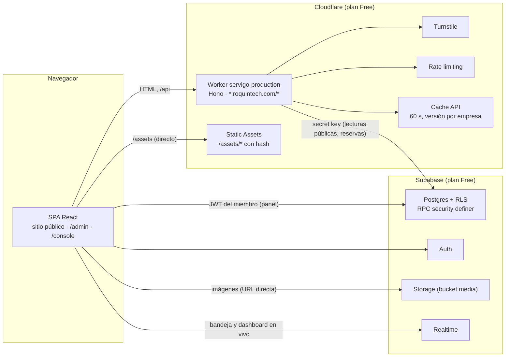
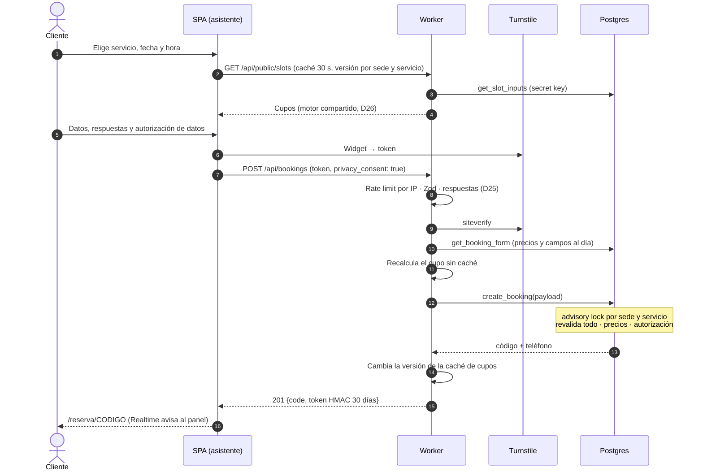

# Arquitectura de Servigo

Resumen de cómo está hecho Servigo v1. Las decisiones y sus motivos están en [plan/00](plan/00-arquitectura-y-decisiones.md) (D1–D31). El modelo de datos está en [er.md](er.md) y la operación en [runbook.md](runbook.md).

## 1. Piezas

| Pieza | Qué hace | Código |
| --- | --- | --- |
| Worker | Resuelve el tenant por el `Host`, sirve el HTML con meta/SEO, el esqueleto y los datos iniciales, y expone `/api/public/*`, `/api/bookings/*`, `/api/admin/*`, `/api/superadmin/*`, `/api/client-errors` y `/api/health`. Pone las cabeceras de seguridad (CSP con nonce) y registra una línea JSON por petición | `src/worker/` |
| SPA | Sitio público (sin supabase-js en el JS inicial), panel `/admin` y consola `/console`, con carga diferida por ruta | `src/client/` |
| Compartido | Esquemas Zod, motor de cupos, precios, calendario, dashboard y privacidad. TS puro, usado por el Worker, la SPA y las pruebas | `src/shared/` |
| Base de datos | Esquema, RLS, triggers y RPC. Una migración por cambio | `supabase/migrations/` |

## 2. Tenants

- `servigo.roquintech.com` es la plataforma: landing y `/console` del superadmin.
- `{slug}.roquintech.com` es el sitio de la empresa (`/`) y su panel (`/admin`).
- El Worker busca la empresa con `get_company_by_slug` y la guarda en caché. Si no existe, responde 404 desde el Worker.
- Los slugs reservados viven en la tabla `reserved_slugs`.
- En local se usa `{slug}.localhost:5273`.

## 3. Seguridad

- **Aislamiento**:
  - Toda tabla tiene `company_id` y RLS.
  - Los triggers impiden referencias entre empresas.
  - `anon` no lee tablas: solo una lista cerrada de RPC.
  - Lo vigilan `anon.test.sql` y `fase13_security_audit.test.sql`, y la E2E de aislamiento de la fase 13.
- **Escrituras sensibles** por RPC `security definer` con `search_path = ''`:
  - reservas (D28, D29);
  - anonimización (D31);
  - métricas del dashboard (D30).
- **Secret key de Supabase**: solo vive en el Worker y en GitHub. CI comprueba que no aparece en `dist/client`.
- **Cabeceras**:
  - CSP con nonce por respuesta, sin `unsafe-eval`;
  - `frame-ancestors 'none'`, `nosniff`, `Referrer-Policy` y `Permissions-Policy`;
  - en `/assets`, solo `nosniff` y caché larga (`public/_headers`).
- **Reserva pública**: Turnstile y rate limit por IP (crear 10/min, buscar 5/min). La BD revalida bajo un *advisory lock* (D28).
- **Datos personales**:
  - política de privacidad por empresa y autorización obligatoria en la reserva web;
  - derecho de supresión con `anonymize_customer` (D31).

## 4. Reserva pública (secuencia)

## 5. Rendimiento y límites gratuitos

- **JS inicial del sitio público** ≤ 150 KiB gzip; hoy unos 145 KiB. Lo vigila `scripts/check-bundle.mjs` en CI.
- **Esqueleto estático y datos de la página en el HTML** (D27): LCP de 1,6–1,9 s en Lighthouse con perfil 4G.
- **Imágenes**:
  - WebP comprimidas en el navegador;
  - servidas directo desde Supabase Storage, sin pasar por el Worker (D14, D22).
- **Lecturas públicas**: Cache API de 60 s con una versión por empresa, y purga al guardar (D27).
- **Límites gratuitos y qué hacer al acercarse**: [runbook.md §12](runbook.md#12-capacidad-y-límites-gratuitos).

## 6. Observabilidad

- **Workers Logs**:
  - una línea `{"msg":"request", tenant, method, route, status, duration}` por petición;
  - errores `db_error`, `booking_rpc_failed`, `public_read_failed` y `client_error`.
- **Errores del navegador**: errores no capturados, promesas rechazadas, errores de ruta y violaciones de CSP van a `POST /api/client-errors`.
  - Máximo 5 por página.
  - Limitado por IP.
  - El texto se limpia de correos, teléfonos, tokens y códigos.
- **Salud**: `/api/health?db=1`.
  - Lo usan `keepalive`, dos veces por semana.
  - También `uptime`, cada hora; GitHub avisa por correo si falla.

## 7. Calidad

| Qué | Dónde |
| --- | --- |
| Lint, tipos, formato y pruebas unitarias con cobertura: `src/shared` ≥ 90 %; total de la lógica (`src/shared` + `src/worker`) ≥ 70 % | job `ci` |
| Presupuesto de JS y sin secretos en el bundle | job `ci` |
| Migraciones desde cero, pgTAP, `db lint`, *advisors* sin avisos y tipos al día | job `db` |
| E2E en Chromium y Safari de iPhone (`@mobile`), axe y Lighthouse CI | job `e2e` |
| Smoke test, incluidas las cabeceras de seguridad | workflow `deploy` |
