# Modelo de datos (ER)

Esquema `public` creado en la fase 02 (`supabase/migrations/`). Todas las tablas de tenant tienen `company_id` (con borrado en cascada desde `companies`), `created_at` y `updated_at`. Para no saturar el diagrama, las relaciones hacia `companies` solo se dibujan en las tablas raíz.

```mermaid
erDiagram
    auth_users ||--o| platform_admins : "es superadmin"
    auth_users ||--o{ company_members : "pertenece"

    companies ||--o{ company_members : tiene
    companies ||--o{ company_invitations : invita
    companies ||--o{ branches : tiene
    companies ||--o{ catalog_items : ofrece
    companies ||--o{ booking_fields : pide
    companies ||--o{ availability_events : "abre/cierra"
    companies ||--o{ customers : atiende
    companies ||--o{ about_sections : publica
    companies ||--o{ social_links : enlaza

    branches ||--o{ sponsors : muestra
    branches |o--o{ about_sections : "sección propia"
    branches |o--o{ social_links : "redes propias"
    branches |o--o{ availability_events : "ventanas propias"
    branches ||--o{ branch_catalog_items : "catálogo propio"
    branches ||--o{ bookings : recibe
    branches |o--o{ discounts : "solo en sede"

    catalog_items ||--o{ catalog_item_details : detalla
    catalog_items ||--o{ catalog_item_photos : "fotos (máx. 8)"
    catalog_items ||--o{ discounts : descuenta
    catalog_items ||--o{ branch_catalog_items : "por sede"
    catalog_items ||--o{ service_products : "servicio → add-ons"
    catalog_items |o--o{ booking_fields : "campos del servicio"
    catalog_items ||--o{ bookings : "servicio reservado"

    availability_events |o--o{ availability_events : "excepción de serie"

    customers ||--o{ bookings : reserva
    bookings ||--o{ booking_items : "productos"
    bookings ||--o{ booking_answers : "información adicional"
    bookings ||--o{ booking_events : historial
    booking_fields |o--o{ booking_answers : responde

    companies {
        uuid id PK
        citext slug UK "subdominio; contra reserved_slugs"
        text name
        jsonb footer
        jsonb booking_settings
        jsonb seo
        text privacy_policy "null = plantilla (fase 13)"
        company_status status
    }
    reserved_slugs {
        citext slug PK
        text reason "system | roquintech_product"
    }
    company_members {
        uuid company_id FK
        uuid user_id FK
        member_role role "owner | admin | staff"
        uuid_array branch_ids "null = todas"
    }
    branches {
        uuid id PK
        citext slug "URL /s/slug"
        text timezone "null = el de la empresa"
        bool own_availability
        bool own_catalog
    }
    catalog_items {
        uuid id PK
        catalog_kind kind "service | product"
        numeric price
        int duration_minutes "obligatorio en servicios"
        int capacity
        bool allow_in_booking "productos add-on"
    }
    availability_events {
        uuid id PK
        uuid branch_id "null = nivel empresa"
        availability_kind kind "open | closed"
        timestamptz starts_at
        timestamptz ends_at
        text rrule "RFC 5545"
        timestamptz_array exdates
    }
    bookings {
        uuid id PK
        text code "8 car. Crockford, único por empresa"
        booking_status status
        timestamptz starts_at
        timestamptz block_starts_at "con buffers"
        numeric total
        timestamptz privacy_consent_at "reserva web (fase 13)"
    }
    customers {
        uuid id PK
        text phone "E.164 (o anon-… si se anonimizó), único por empresa"
        citext email
        timestamptz anonymized_at
    }
```

## Reglas que no se ven en el diagrama

- **RLS** en todas las tablas. `anon` no tiene privilegios sobre tablas: el sitio público usa solo RPC (`ping`, `get_company_by_slug` y, desde las fases 09–10, las de sitio y reservas).
- **Consistencia entre tenants**: el trigger `enforce_company_consistency` verifica que cada referencia (incluidos los arrays `branch_ids` y `service_ids`) apunte a filas de la misma empresa. `lock_company_id` impide mover filas entre empresas.
- **Tipos de ítem**: `enforce_item_kind` exige servicio/producto donde corresponde (`service_products`, `booking_fields`, `bookings`, `booking_items`).
- **Solo el superadmin** cambia `slug` y `status` de una empresa (`companies_guard_platform_fields`).
- **Storage**: bucket público `media`; solo owner/admin escriben bajo `{company_id}/…`.
- **Reservas**: el panel solo las escribe por RPC (`create_booking_admin`, `change_booking_status`, `reschedule_booking`, `update_booking_admin`; D29) y el sitio por el Worker (`create_booking`, D28). `anonymize_customer` borra los datos personales de un cliente y conserva sus reservas (D31).
- **Auditoría** (`supabase/tests/anon.test.sql` y `fase13_security_audit.test.sql`): toda tabla con RLS y al menos una política, `anon` sin privilegios de tabla y con una lista cerrada de RPC, y toda función `security definer` con `search_path = ''`.
