# Manual de Servigo para empresas

Guía para configurar tu sitio de reservas y gestionar el día a día. Tu sitio está en `https://tu-empresa.roquintech.com` y el panel en `https://tu-empresa.roquintech.com/admin`.

> Las capturas usan la empresa de ejemplo «Barbería Demo». Tu panel se ve igual, con tus colores.

**Contenido**

1. [Entrar al panel](#1-entrar-al-panel)
2. [Primeros pasos (lista rápida)](#2-primeros-pasos-lista-rápida)
3. [Tu empresa](#3-tu-empresa)
4. [Sedes](#4-sedes)
5. [Servicios y productos](#5-servicios-y-productos)
6. [Información adicional](#6-información-adicional)
7. [Horario de atención (calendario)](#7-horario-de-atención-calendario)
8. [Contenido del sitio](#8-contenido-del-sitio)
9. [Reglas de reserva](#9-reglas-de-reserva)
10. [Tu equipo](#10-tu-equipo)
11. [Gestionar reservas](#11-gestionar-reservas)
12. [Clientes y sus datos](#12-clientes-y-sus-datos)
13. [Inicio: cómo va tu negocio](#13-inicio-cómo-va-tu-negocio)
14. [Lo que ve tu cliente](#14-lo-que-ve-tu-cliente)
15. [Preguntas frecuentes](#15-preguntas-frecuentes)

## 1. Entrar al panel

1. Roquintech crea tu empresa y te envía una **invitación** por correo. Ábrela, crea tu contraseña (mínimo 8 caracteres) y entrarás como **propietario**.
2. Después, entra en `/admin/login` con tu correo y contraseña. Si la olvidas, usa **¿Olvidaste tu contraseña?**.

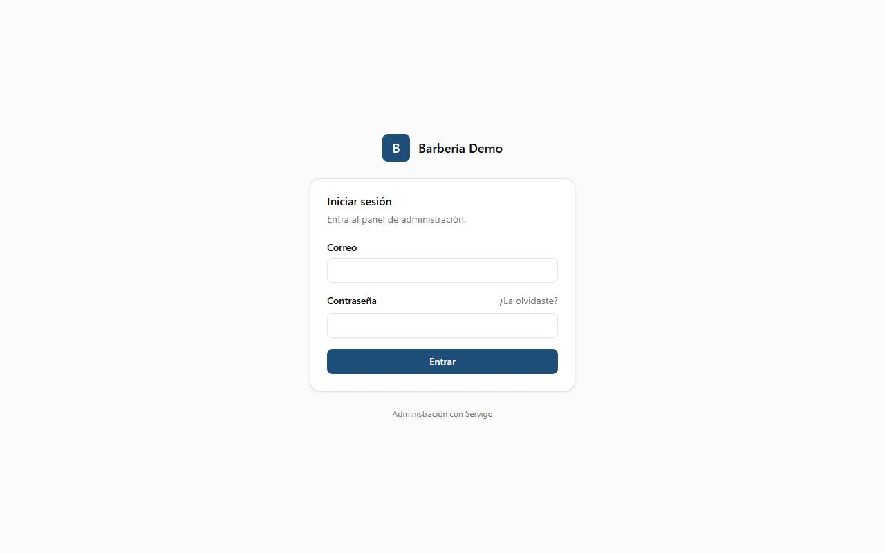

Tu sesión es solo de tu empresa: si trabajas con dos empresas en Servigo, entras a cada una por su propia dirección.

## 2. Primeros pasos (lista rápida)

Para recibir la primera reserva, en este orden:

1. **Configuración → Empresa**: logo, colores y contacto ([§3](#3-tu-empresa)).
2. **Sitio público → Sedes**: al menos una sede con dirección ([§4](#4-sedes)).
3. **Catálogo → Servicios**: tus servicios con precio y duración ([§5](#5-servicios-y-productos)).
4. **Operación → Calendario**: tu horario de atención ([§7](#7-horario-de-atención-calendario)). Sin horario no hay cupos.
5. **Configuración → Reservas**: si confirmas tú o se confirman solas ([§9](#9-reglas-de-reserva)).
6. **Sitio público → Privacidad**: revisa la política de datos ([§8](#8-contenido-del-sitio)).
7. Abre **Ver sitio público** (arriba a la derecha) y haz una reserva de prueba.

## 3. Tu empresa

**Configuración → Empresa**: nombre, logo, colores de marca, correo, teléfono, WhatsApp, zona horaria, moneda, y título y descripción para Google y redes (SEO).

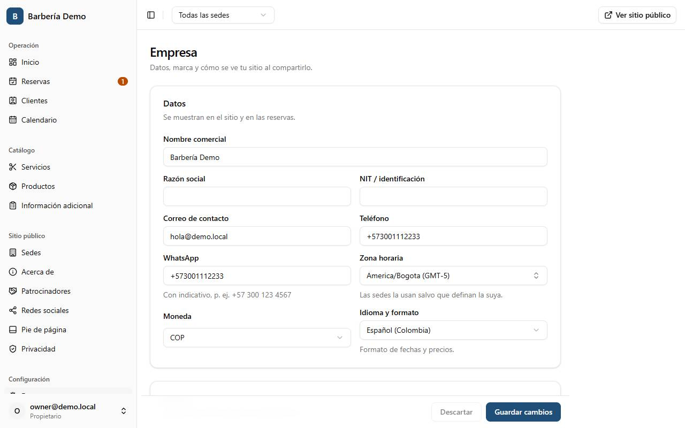

- Las imágenes se recortan y comprimen en tu navegador: sube JPG, PNG o WebP de buena calidad y elige el encuadre.
- Los cambios se ven en el sitio en unos segundos.

## 4. Sedes

**Sitio público → Sedes**: cada sede tiene nombre, dirección, ciudad, teléfono, enlace de Google Maps, portada y una dirección propia (`/s/nombre-de-la-sede`).

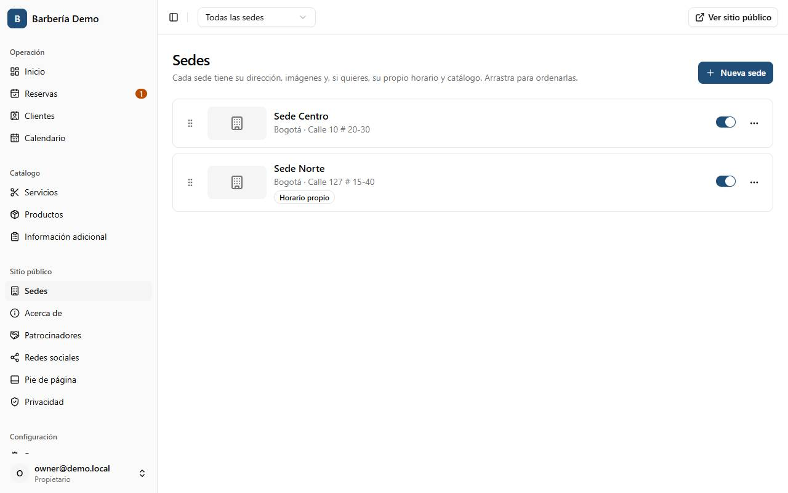

- **Ordenar**: arrastra las tarjetas o usa el teclado. El orden es el del sitio.
- **Horario propio**: si está apagado, la sede usa el horario general de la empresa.
- **Catálogo propio**: si está encendido, eliges qué servicios ofrece la sede y puedes cambiar su precio solo ahí.
- Una sede con reservas no se puede borrar: se **inactiva**. Siempre debe quedar al menos una sede activa.

## 5. Servicios y productos

**Catálogo → Servicios** y **Catálogo → Productos**.

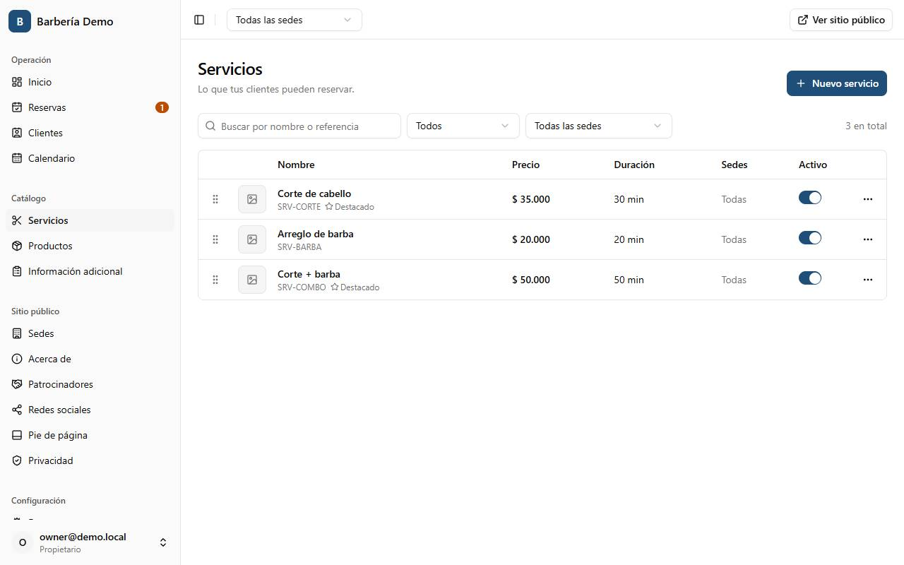

En la ficha de un servicio:

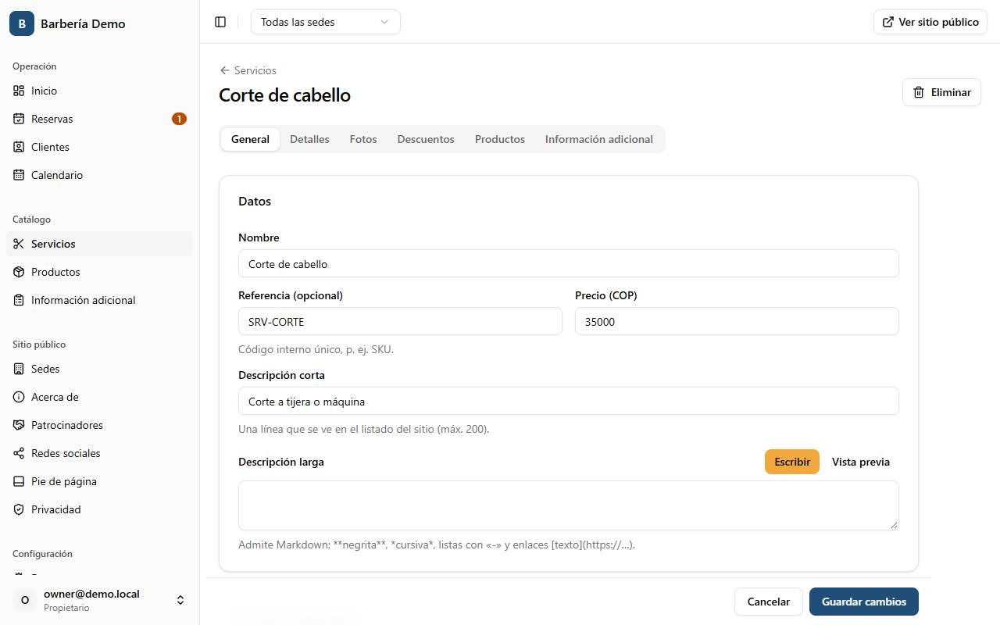

- **Precio y duración**. Los **tiempos antes y después** (preparación o limpieza) bloquean la agenda pero el cliente no los ve.
- **Capacidad**: cuántas personas caben en el mismo horario (1 para un corte; 8 para una clase grupal).
- **Fotos**: hasta 8. La marcada como portada sale en las tarjetas. Describe cada foto: lo leen las personas con lector de pantalla.
- **Detalles**: hasta 30 líneas tipo «Incluye: lavado».
- **Descuentos**: porcentaje o valor fijo, con fecha límite y, si quieres, solo en una sede. Si hay varios, se aplica el que más ahorra.
- **Productos complementarios**: productos que el cliente puede añadir al reservar, como un shampoo.
- **Duplicar** crea una copia para editar. Un servicio con reservas no se borra: se inactiva.

Los **productos** usan la misma ficha, sin duración. Marca «Añadir a la reserva» para ofrecerlos como complemento, y usa el inventario si quieres controlar existencias.

## 6. Información adicional

**Catálogo → Información adicional**: preguntas que el cliente responde al reservar, por ejemplo «¿Cómo nos conociste?» o «Alergias».

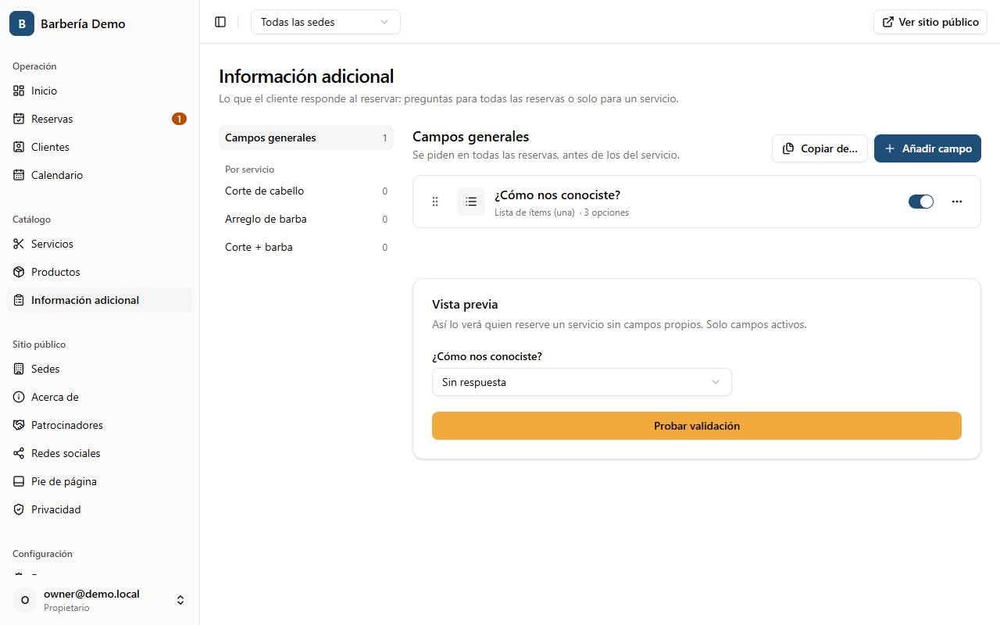

- **Generales**: aplican a todos los servicios. **De un servicio**: solo a ese.
- **Tipos**: texto corto o largo, lista, varias opciones, sí/no, número y fecha. Pueden ser obligatorios.
- **Vista previa**: muestra el formulario tal como lo verá el cliente.
- Renombrar una opción no cambia las respuestas pasadas. Un campo con respuestas no se borra: se inactiva.

## 7. Horario de atención (calendario)

**Operación → Calendario** funciona como Google Calendar: arrastra en la grilla para crear una **ventana de atención** (verde) o un bloque **no disponible**, como el almuerzo o un festivo.

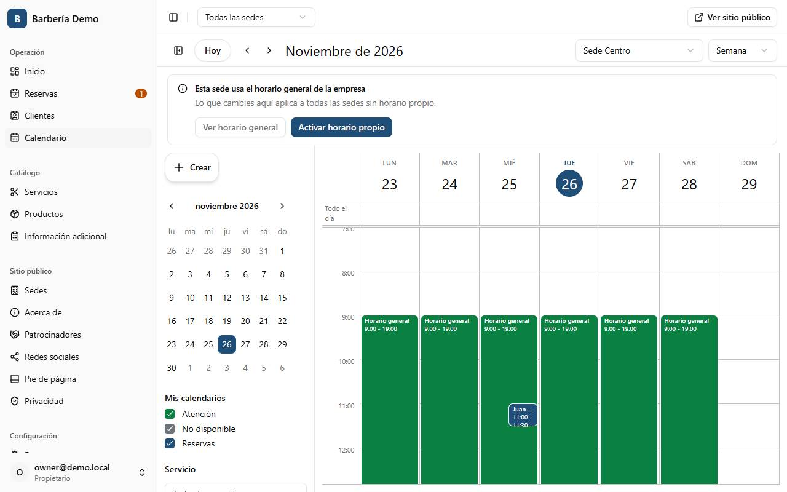

- **Repetir**: cada día, semana o mes, con excepciones. Al editar uno que se repite, eliges entre **Solo este**, **Este y los siguientes** o **Todos**.
- **Deshacer**: aparece después de cada cambio.
- **Vista previa de cupos**: muestra los horarios que verá el cliente para un servicio.
- **Reservas**: aparecen en el color de tu marca. Haz clic para ver el detalle; arrastra una para reprogramarla.
- **Atajos de teclado**: `D` día, `W` semana, `M` mes, `A` agenda, `T` hoy, `J`/`K` adelante y atrás, `C` crear, `Esc` cerrar. Con `Tab` llegas a cada evento y con `Enter` lo abres.
- Elige la sede arriba a la izquierda. Si la sede no tiene horario propio, editas el horario de la empresa.

## 8. Contenido del sitio

En **Sitio público**:

- **Acerca de**: la historia de tu empresa y, si quieres, una sección por sede. Admite títulos, negrita, listas y enlaces.

  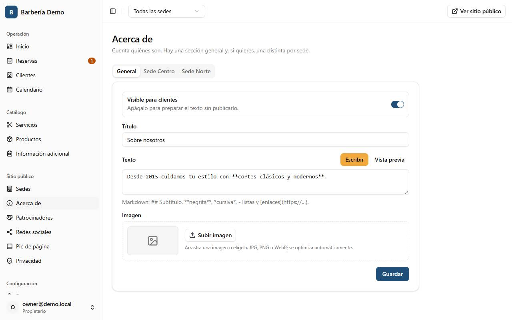

- **Patrocinadores**: logos y enlaces de aliados, por sede.
- **Redes sociales**: Instagram, Facebook, TikTok, WhatsApp, etc. Una sede puede tener las suyas o heredar las de la empresa.
- **Pie de página**: texto, dirección y enlaces del final de cada página.
- **Privacidad**: tu **política de tratamiento de datos** (Ley 1581 de 2012), en `/privacidad` y enlazada en el pie de página y en el paso de datos de la reserva.
  - Al empezar ves una **plantilla** con tu nombre y datos de contacto. Es una guía: revísala con tu asesor y ajústala a lo que haces con los datos.
  - Al guardar, el texto queda fijo. **Volver a la plantilla** lo descarta.

  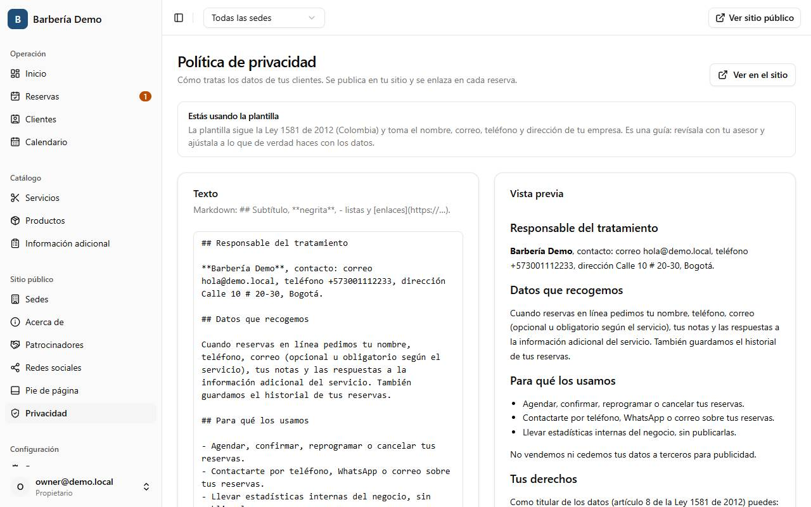

## 9. Reglas de reserva

**Configuración → Reservas**:

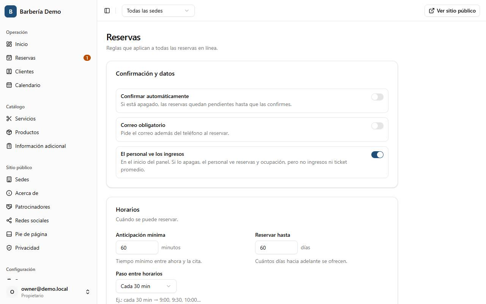

- **Confirmar automáticamente**: si está apagado, las reservas quedan **pendientes** hasta que las confirmes.
- **Correo obligatorio**: pide el correo además del teléfono.
- **El personal ve los ingresos**: si lo apagas, el personal ve reservas y ocupación, pero no dinero.
- **Anticipación mínima**: por ejemplo, 2 horas. **Reservar hasta**: cuántos días hacia adelante se ofrecen. **Paso entre horarios**: cada cuántos minutos empieza un cupo.
- **El cliente puede cancelar**: desde «Mis reservas», hasta cierto número de horas antes.
- **Términos y condiciones**: si escribes algo, el cliente debe aceptarlo para reservar.

La **autorización de datos personales** siempre se pide y no se puede quitar: la exige la ley.

## 10. Tu equipo

**Configuración → Miembros**: invita por correo. Cada persona recibe un enlace para crear su contraseña.

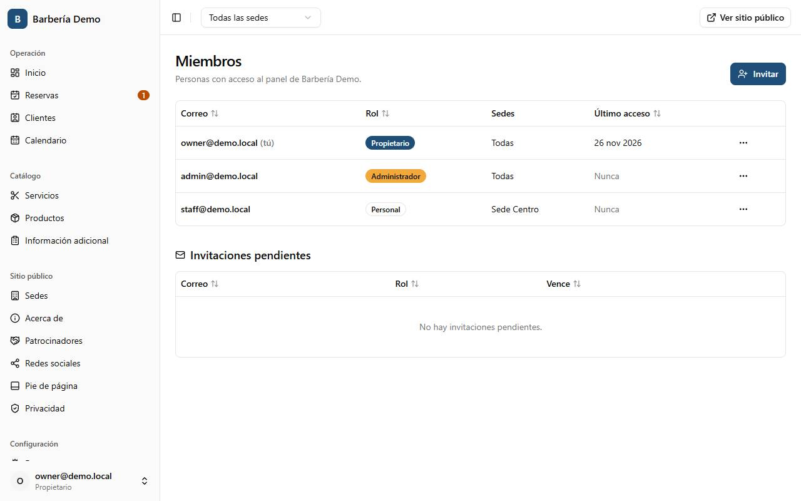

| Rol | Puede |
| --- | --- |
| **Propietario** | Todo, incluidos otros propietarios y administradores y eliminar datos de clientes |
| **Administrador** | Todo menos gestionar propietarios y administradores |
| **Personal** | Reservas, clientes y calendario de **sus sedes asignadas**. El catálogo solo lo ve |

Siempre queda al menos un propietario.

## 11. Gestionar reservas

**Operación → Reservas**. El número naranja del menú son las reservas pendientes. Cuando entra una reserva nueva, el panel avisa con un sonido, que puedes silenciar.

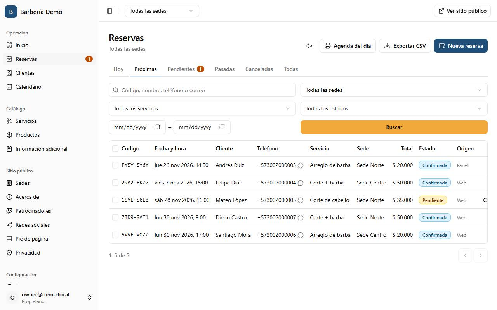

- **Pestañas**: Hoy, Próximas, Pendientes, Pasadas, Canceladas y Todas. Puedes buscar por código, nombre, teléfono o correo, y filtrar por sede, servicio y estado.
- **Selección múltiple**: confirma o cancela varias a la vez.
- **Exportar CSV**: descarga lo que estás viendo, con los filtros aplicados, para Excel o Google Sheets.
- **Agenda del día**: lista imprimible de las reservas de un día.
- **Nueva reserva**: para quien llama o llega sin reservar. Propietarios y administradores pueden **forzar** un horario fuera de disponibilidad.

Al abrir una reserva:

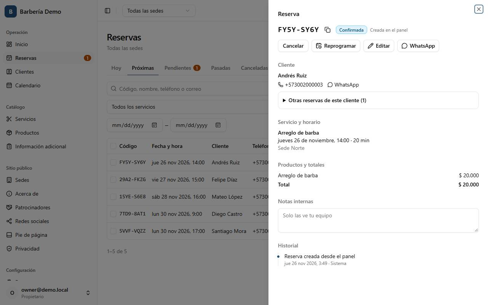

- **Estados**: Pendiente → Confirmada → Completada o No asistió. Las pendientes o confirmadas se pueden **cancelar**, con un motivo opcional.
- **Reprogramar**: muestra los cupos libres.
- **Editar**: cambia los datos del cliente, los productos y las respuestas. Los precios se conservan salvo que elijas actualizarlos.
- **WhatsApp**: abre tu WhatsApp con un mensaje listo (confirmación, recordatorio, cambio de horario…). No tiene costo.
- **Notas internas**: solo las ve tu equipo.
- **Historial**: quién hizo cada cambio y cuándo.

## 12. Clientes y sus datos

**Operación → Clientes**: se crean solos con cada reserva, identificados por el teléfono. Verás sus reservas, su última visita y el total gastado.

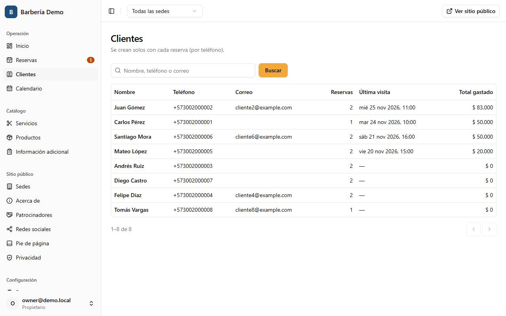

**Si un cliente pide borrar sus datos** (derecho de supresión, Ley 1581): el **propietario** abre el cliente y usa **Eliminar datos personales**.

- Se borran nombre, teléfono, correo, notas y respuestas de todas sus reservas.
- Las reservas se conservan sin datos personales, así que tus cifras no cambian.
- No se puede deshacer, y el cliente ya no podrá consultar esas reservas con su teléfono.
- Tienes 15 días hábiles para atender un reclamo y 10 para una consulta.

## 13. Inicio: cómo va tu negocio

**Operación → Inicio** resume el periodo que elijas (Hoy, 7 días, 30 días, Este mes o Personalizado) en la sede seleccionada arriba:

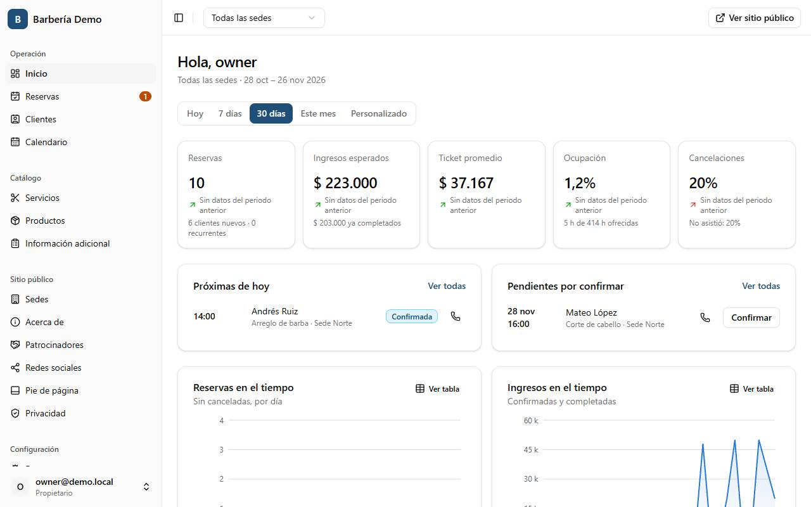

- **Indicadores**: reservas, ingresos esperados, ticket promedio, ocupación y cancelaciones, con la variación frente al periodo anterior.
- **Listas del día**: próximas de hoy y pendientes por confirmar, con botones para confirmar y llamar.
- **Gráficas**: reservas e ingresos en el tiempo, servicios y productos más vendidos, días y horas con más demanda, reparto por estado, ocupación por servicio y comparación entre sedes. Cada gráfica tiene **Ver tabla** con los números.
- **Ocupación**: tiempo reservado dividido por el tiempo de atención ofrecido. Si el periodo incluye días futuros, baja porque esos días aún no tienen reservas.
- Mientras no tengas reservas, el Inicio muestra el enlace de tu sitio y un **código QR** para imprimir.

## 14. Lo que ve tu cliente

Tu cliente no necesita cuenta. En su celular:

| Inicio | Sede | Reservar | Mis reservas |
| --- | --- | --- | --- |
| 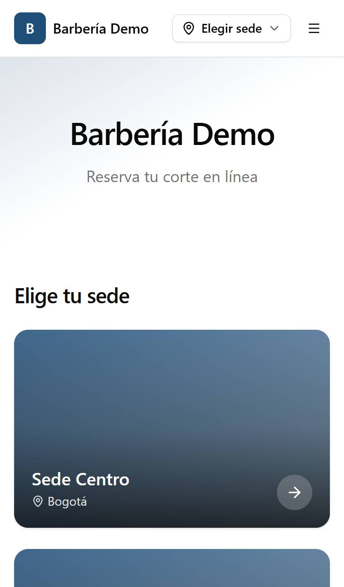 | 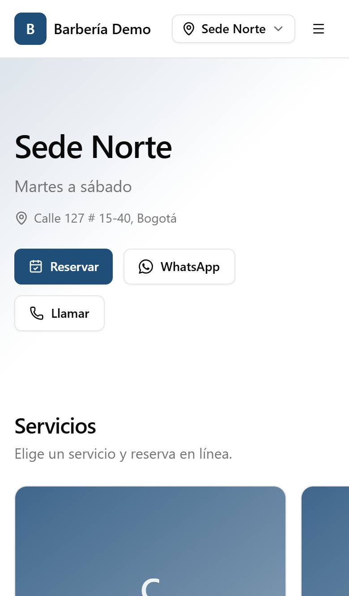 | 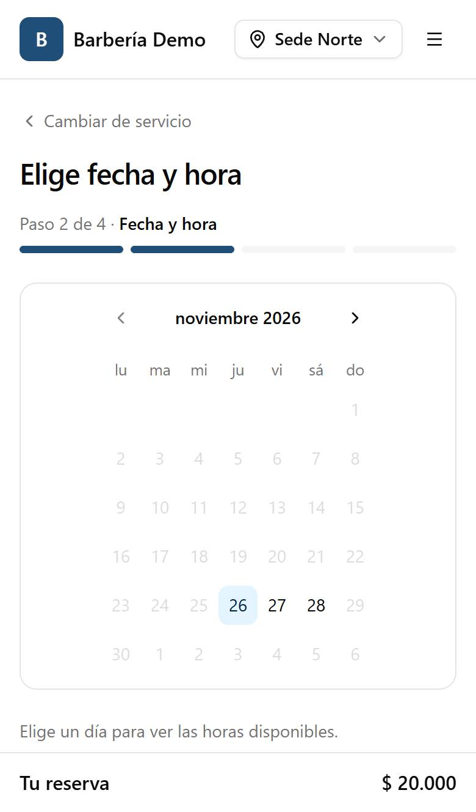 | 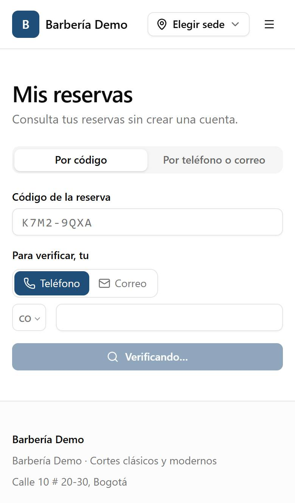 |

1. Elige sede y servicio, fecha y hora, productos complementarios (si hay) y escribe sus datos.
2. Marca la **autorización de datos** y, si los tienes, los términos.
3. Recibe un **código** (ej. `K7M2-9QXA`) y puede añadir la cita a su calendario.
4. En **Mis reservas** la consulta con el código o con su teléfono, y la cancela si tus reglas lo permiten.

## 15. Preguntas frecuentes

- **No aparecen horarios para reservar.** Revisa que la sede tenga horario de atención en el Calendario y que el servicio esté activo en esa sede. La **vista previa de cupos** del calendario muestra lo mismo que ve el cliente.
- **Un cliente dice que el horario está lleno.** Otra persona lo tomó segundos antes. El sistema nunca permite dos reservas en un cupo de capacidad 1.
- **Cambié algo y el sitio no se actualiza.** Tus visitantes lo ven al instante. En tu propio navegador puede tardar hasta 1 minuto: recarga.
- **¿Puedo usar mi propio dominio?** No en esta versión. Tu sitio vive en `tu-empresa.roquintech.com`.
- **¿Servigo cobra comisión por reserva o envía SMS?** No. Los avisos al cliente son por WhatsApp desde tu propio teléfono.
- **¿Quién ve los datos de mis clientes?** Solo tu equipo, según su rol y sus sedes. Ninguna otra empresa de Servigo puede verlos.
